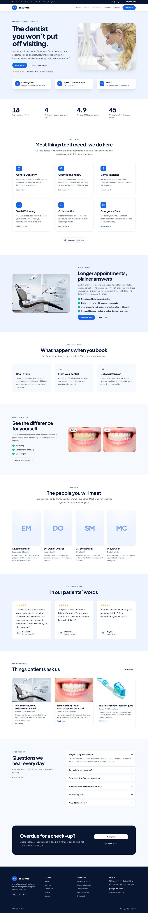

# Perla – tema a blocchi (Gutenberg) per studi dentistici

Questo ramo (`perla-gutenberg`) contiene due cose, pensate per WordPress.org:

- **Perla**, il tema a blocchi: tutto è fatto con i blocchi standard di WordPress, senza Divi.
- **Perla Starter**, un piccolo plugin che con un clic crea tutto il sito: le pagine con blocchi veri, il menu, tre articoli, e imposta la Home come pagina iniziale.

La versione per **Divi 5** (quella da vendere su Etsy) resta sul ramo `claude/vibrant-feynman-ymcauf`. I due rami sono indipendenti.



Altre anteprime in [`docs/previews`](docs/previews): le pagine interne, il telefono, lo slider prima / dopo, la schermata del plugin, la finestra "scegli un pattern".

## Come funziona per il cliente

1. **Installa e attiva il tema.** La home compare subito, senza creare nulla.
2. **Installa e attiva Perla Starter**, poi Aspetto → Perla Starter → "Build the site". In pochi secondi ci sono 17 pagine fatte di blocchi normali, il menu, tre articoli di esempio e le foto nella Libreria media. La pagina Home diventa la pagina iniziale e Journal la pagina degli articoli.
3. **Modifica.** Ogni pagina, Home compresa, si apre e si modifica come qualsiasi pagina di WordPress.

Il plugin non sovrascrive nulla: se una pagina con lo stesso indirizzo esiste già, la lascia com'è. Un secondo clic non crea doppioni. C'è un pulsante per annullare, che sposta nel cestino ciò che il plugin ha creato e rimette le impostazioni di prima. Finito il lavoro, il plugin si può anche disinstallare: le pagine restano.

Chi non vuole il plugin crea le pagine a mano: Pagine → Aggiungi, WordPress propone i pattern, due clic per pagina.

### La home

Finché non esiste una pagina iniziale con del contenuto, il tema mostra la sua home già pronta. Appena il cliente (o il plugin) imposta come homepage una pagina con del contenuto, il tema mostra quella. Così il sito non sembra mai vuoto e la home resta una pagina normale.

### Perché serve un plugin a parte

WordPress.org non permette ai temi di creare pagine né di importare contenuti: lo permette ai plugin. Per questo la creazione del sito sta in Perla Starter. Un tema può consigliare un plugin solo se è già su WordPress.org, quindi per ora il tema non lo nomina: quando il plugin sarà approvato si potrà aggiungere il consiglio.

## Cosa c'è

| Cosa | Dove | Note |
| --- | --- | --- |
| Colori, font, misure | `theme/perla/theme.json` | Si cambiano da Aspetto → Editor → Stili |
| Sezioni | `theme/perla/patterns/` | 25 sezioni, nell'inseritore sotto "Perla sections" |
| Pagine intere | `theme/perla/patterns/page-*.php` | 15: Home, Chi siamo, Team, Recensioni, Trattamenti, 6 trattamenti, Prezzi, Prima visita, Domande, Contatti |
| Header e footer | `theme/perla/parts/`, `patterns/` | Due header e due footer tra cui scegliere |
| Blog, articolo, archivio, ricerca, 404 | `theme/perla/templates/` | 8 template |
| Prima / dopo trascinabile | `assets/js/compare.js` | Due immagini normali in un gruppo; lo script le trasforma in slider |
| Animazioni e scorrimento fluido | `assets/js/motion.js`, `lenis.js` | Si spengono da Aspetto → Personalizza → Animazioni |
| Foto, icone, font | `theme/perla/assets/` | Licenze accettate da WordPress.org, elenco in `readme.txt` |
| Plugin | `plugin/perla-starter/` | Un file PHP, i dati del sito in `data/site.json` |

## Come sono stati convertiti i moduli Divi

| In Divi | In Gutenberg |
| --- | --- |
| Sezione, riga, colonna | Gruppo, Colonne, Griglia |
| Blurb (icona, titolo, testo) | Gruppo con Immagine (icona SVG), Titolo, Paragrafo |
| Contatore numerico | Paragrafo: il conteggio lo fa `motion.js` |
| Accordion delle domande | Blocco Dettagli |
| Testimonianza, Persona, Tabella prezzi | Gruppi con titoli, paragrafi, elenchi, tabelle e pulsanti |
| Modulo Blog | Query Loop |
| Prima / dopo | Gruppo con due immagini, trascinabile grazie a `compare.js` |
| Header, footer e template del Theme Builder | Template part e template del tema |
| Colori, font e variabili globali di Divi | `theme.json` |
| Sito demo creato all'attivazione | Plugin Perla Starter |

## Cosa cambia rispetto alla versione Divi, e perché

Queste differenze servono a rispettare le regole di WordPress.org.

- **Le pagine le crea il plugin, non il tema.** Un clic in più, ma è l'unico modo ammesso.
- **Niente modulo contatti e niente mappa.** I moduli spettano ai plugin, e una mappa esterna non è ammessa senza consenso. Nella pagina Contatti ci sono due pulsanti, "chiama" e "scrivi": chi vuole un modulo mette al loro posto il blocco del suo plugin.
- **Foto diverse.** Le foto Pexels della versione Divi non hanno una licenza compatibile con la GPL. Qui ci sono 9 fotografie CC0 (da PxHere, rawpixel e StockSnap), usate in 11 immagini. Nessuna mostra minori.
- **Animazioni senza GSAP.** La licenza di GSAP non è compatibile con la GPL. Le stesse animazioni sono riscritte in `motion.js`. Lenis è rimasto perché è MIT.
- **Icone disegnate apposta** (15 SVG) al posto del font di icone di Divi.
- **Foto del team:** un segnaposto da sostituire, oppure la variante con le iniziali.

## Provarlo sul computer

Serve Docker.

```bash
./bin/setup.sh
```

Il sito è su http://localhost:8080 (utente `admin`, password `admin`). Lo script installa WordPress, attiva tema e plugin e fa costruire il sito al plugin, come farebbe un clic sul suo pulsante.

## Prima di inviare a WordPress.org

Tema e plugin si inviano separatamente.

1. **Controlla i nomi.** Come autore c'è "Fontana Jonathan" e nella riga `Contributors:` dei due `readme.txt` (tema e plugin) c'è il nome utente di WordPress.org `grayfox86`. Tema e plugin vanno caricati con quell'account.
2. **Crea gli zip.**

   ```bash
   ./bin/package.sh
   ```

   Escono `dist/perla.zip` (tema) e `dist/perla-starter.zip` (plugin).
3. **Carica il tema** su https://wordpress.org/themes/upload/.
4. **Carica il plugin** su https://wordpress.org/plugins/developers/add/. Conviene farlo quando il tema è già stato accettato, perché il plugin funziona solo con Perla.
5. **Aspetta le revisioni.** Per ogni correzione richiesta si aumenta il numero di versione (in `style.css` e `readme.txt` per il tema, in `perla-starter.php` e `readme.txt` per il plugin) e si ricarica lo zip.

Il 14 novembre 2026 risultavano liberi su WordPress.org sia l'indirizzo `perla` tra i temi sia `perla-starter` tra i plugin. Su WordPress.org tema e plugin sono gratuiti.

## Modificare il tema

Per piccole modifiche basta l'editor del sito di WordPress.

Per cambiare i testi o le sezioni di partenza, le sezioni sono descritte in `src/`:

- `src/content.js`: i testi (trattamenti, team, recensioni, domande, prezzi).
- `src/patterns.js`: le sezioni e le pagine.
- `src/templates.js`: i template.
- `src/blocks.js`: i mattoncini con cui sono scritte.

Dopo una modifica:

```bash
npm run build
```

Lo script passa le sezioni all'editor di WordPress del sito di prova e fa scrivere a lui il codice dei blocchi. Così i file contengono esattamente ciò che l'editor salverebbe, e nessun blocco si apre con l'avviso "contenuto non valido". Scrive anche `plugin/perla-starter/data/site.json`, l'elenco di pagine, menu e articoli che il plugin crea.

I file consegnati sono stati generati con WordPress 6.6, la versione più vecchia che il tema dichiara di supportare: il codice scritto dalla versione più vecchia è letto anche da tutte quelle successive. Per rifarlo allo stesso modo serve un sito con WordPress 6.6 e `WP_URL=http://indirizzo-del-sito npm run build`.

Una cosa da sapere: WordPress tiene in memoria l'elenco dei pattern di un tema finché non cambia il numero di versione. Se aggiungi un pattern, aumenta `Version` in `style.css`, altrimenti i siti che hanno già il tema non lo vedono. Il sito di prova non ha questo problema perché è in modalità sviluppo.

### I nomi delle funzioni

Le funzioni hanno nomi presi da Metal Gear Solid, sempre dietro il prefisso che WordPress.org richiede.

Nel tema (`functions.php`):

| Funzione | Cosa fa |
| --- | --- |
| `perla_dog_tag` | Versione del tema |
| `perla_shadow_moses` | Stili del tema anche nell'editor |
| `perla_octocamo` | Carica `style.css` |
| `perla_stealth_camo` | Stili aggiuntivi dei blocchi |
| `perla_codec` | Categorie dei pattern |
| `perla_big_boss` | Decide se la home mostra la pagina del cliente o quella pronta |
| `perla_psycho_mantis` | Carica lo slider prima / dopo solo dove serve |
| `perla_otacon` | I due interruttori in Aspetto → Personalizza |
| `perla_grey_fox` | Controlla il valore degli interruttori |
| `perla_liquid_snake` | Carica animazioni e scorrimento fluido |

Nel plugin (`perla-starter.php`):

| Funzione | Cosa fa |
| --- | --- |
| `perla_starter_codec` | Voce di menu sotto Aspetto |
| `perla_starter_frequency` | Collegamento rapido nell'elenco dei plugin |
| `perla_starter_briefing` | La schermata |
| `perla_starter_colonel` | Riceve il clic e controlla i permessi |
| `perla_starter_intel` | Legge l'elenco di pagine, menu e articoli |
| `perla_starter_suit_on` | Verifica che il tema Perla sia attivo |
| `perla_starter_nanomachines` | Trasforma un pattern in blocchi veri |
| `perla_starter_fulton` | Copia una foto nella Libreria media |
| `perla_starter_extraction` | Collega le immagini alle foto della Libreria |
| `perla_starter_soliton` | Costruisce il menu |
| `perla_starter_outer_heaven` | Crea il sito |
| `perla_starter_foxdie` | Annulla |
| `perla_starter_game_over` | Pulisce le opzioni quando il plugin viene eliminato |

## Controlli

```bash
npm run check           # ogni blocco di pattern, template e pagine è valido per l'editor, ogni immagine si carica
npm run check:motion    # animazioni, slider prima / dopo, tastiera, movimento ridotto, senza JavaScript
npm run check:starter   # il plugin dalla sua schermata: crea, secondo clic, annulla, ricrea
```

Risultati sulla versione consegnata:

| Controllo | WordPress 6.6.4 | WordPress 7.1.4 |
| --- | --- | --- |
| 3879 blocchi in 50 pattern, 8 template, 2 template part e 16 pagine create dal plugin: tutti validi | sì | sì |
| Plugin dalla sua schermata, su un sito già visitato: 13 prove su 13 | sì | sì, su un sito nuovo con i due zip installati |
| Animazioni, slider, tastiera, movimento ridotto, senza JavaScript: 22 prove su 22 | sì | sì |
| Home identica nelle due versioni (confronto delle schermate) | sì | sì |
| Pagina creata a mano dal pattern "About": 115 blocchi, nessun avviso | sì | sì |
| Theme Check ufficiale (versione 20260901): nessun errore né avviso | non eseguito | sì |
| Plugin Check ufficiale (versione 2.2.0): nessun errore | non eseguito | sì |

Non verificato: Safari e Firefox, telefoni veri (solo le dimensioni simulate in Chromium, compreso il trascinamento dello slider con il dito), le versioni di WordPress tra la 6.7 e la 7.0, PHP diverso da 8.3 (tema e plugin dichiarano 7.4 e usano solo sintassi vecchia, ma non sono stati eseguiti su 7.4), lingue da destra a sinistra, l'esito delle revisioni di WordPress.org.

## Fotografie

Tutte le immagini partono da originali larghi tra 960 e 1200 pixel e nel tema non vengono mai mostrate più larghe di 564 pixel, quindi restano nitide anche sugli schermi ad alta densità.

Le fonti, una per una, sono in `theme/perla/readme.txt`. Per le due foto di PxHere la licenza CC0 è stata letta sulla pagina della foto. Per quelle di rawpixel e StockSnap le pagine non si lasciano leggere in automatico: la licenza CC0 viene dal catalogo Openverse di WordPress.org, che le elenca così. Conviene aprire una volta quei link prima di inviare il tema.

Per rifare i ritagli: salva gli originali come `.photos-cache/<nome>.jpg` (i nomi sono in `tools/photos.py`) ed esegui `python3 tools/photos.py`.

L'immagine "prima" dello slider è la stessa foto con i denti scuriti: è un'illustrazione, non un caso clinico, ed è scritto in `readme.txt`.
