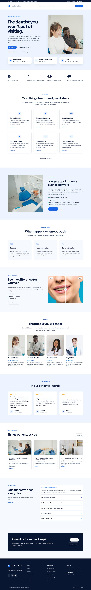

# Perla – tema a blocchi (Gutenberg) per studi dentistici

Questo ramo (`perla-gutenberg`) contiene **Perla riscritto come tema a blocchi di WordPress**, pensato per essere pubblicato su WordPress.org. Non serve Divi né alcun plugin: tutto è fatto con i blocchi standard di WordPress.

La versione per **Divi 5** (quella da vendere su Etsy) resta sul ramo `claude/vibrant-feynman-ymcauf`. I due rami sono indipendenti.



Altre anteprime in [`docs/previews`](docs/previews): le pagine interne, il telefono, la finestra "scegli un pattern" e l'editor.

## Cosa c'è nel tema

Il tema è la cartella [`theme/perla`](theme/perla).

| Cosa | Dove | Note |
| --- | --- | --- |
| Colori, font, misure | `theme.json` | Si cambiano da Aspetto → Editor → Stili |
| Home page | `templates/front-page.html` | È pronta appena si attiva il tema: 11 sezioni |
| Sezioni | `patterns/*.php` | 15 sezioni riutilizzabili, nell'inseritore sotto "Perla sections" |
| Pagine intere | `patterns/page-*.php` | Chi siamo, Trattamenti, 6 trattamenti (uno con listino prezzi), Contatti: WordPress le propone quando si crea una pagina nuova |
| Header e footer | `parts/`, `patterns/header.php`, `patterns/footer.php` | Barra con orari e telefono, menu, footer a 4 colonne |
| Blog, articolo, archivio, ricerca, 404 | `templates/` | 8 template |
| Stile | `style.css` | Solo ciò che `theme.json` non sa descrivere |
| Animazioni | `assets/js/motion.js` | Scritte apposta, senza librerie a pagamento |
| Scorrimento fluido | `assets/js/lenis.js` | Lenis, licenza MIT |
| Foto, icone, font | `assets/` | Tutto con licenze accettate da WordPress.org (elenco in `readme.txt`) |

## Come sono stati convertiti i moduli Divi

| In Divi | In Gutenberg |
| --- | --- |
| Sezione, riga, colonna | Gruppo, Colonne, Griglia |
| Blurb (icona, titolo, testo) | Gruppo con Immagine (icona SVG), Titolo, Paragrafo |
| Contatore numerico | Paragrafo: il conteggio lo fa `motion.js` |
| Accordion delle domande | Blocco Dettagli |
| Testimonianza, Persona, Tabella prezzi | Gruppi con titoli, paragrafi, elenchi e pulsanti |
| Modulo Blog | Query Loop |
| Prima / dopo | Due immagini affiancate con etichetta |
| Header, footer e template del Theme Builder | Template part e template del tema |
| Colori, font e variabili globali di Divi | `theme.json` |
| Sito demo creato all'attivazione | Home come template "Front Page" + pattern di pagina |

## Cosa cambia rispetto alla versione Divi, e perché

WordPress.org ha regole precise per i temi. Queste differenze servono a rispettarle.

- **Niente pagine create in automatico.** Un tema non può creare contenuti. La home compare da sola perché è un template; le altre pagine si creano scegliendo un pattern (due clic ciascuna).
- **Niente modulo contatti e niente mappa.** I moduli spettano ai plugin, e le risorse esterne (come una mappa di Google) non sono ammesse senza consenso. Nella pagina Contatti ci sono due pulsanti, "chiama" e "scrivi": chi vuole un modulo mette al loro posto il blocco del suo plugin.
- **Foto diverse.** Le foto Pexels della versione Divi non hanno una licenza compatibile con la GPL. Qui ci sono 7 fotografie CC0 prese da PxHere, usate in 11 ritagli. Nessuna mostra minori.
- **Animazioni senza GSAP.** La licenza di GSAP non è compatibile con la GPL. Le stesse animazioni (hero che si rimpicciolisce, titoli parola per parola, comparsa a cascata, numeri che contano) sono riscritte in `motion.js`. Lenis è rimasto perché è MIT.
- **Icone disegnate apposta** (12 SVG) al posto del font di icone di Divi.
- **Foto del team sostituite da riquadri con le iniziali**: ognuno ci mette le proprie.

## Provarlo sul computer

Serve Docker.

```bash
./bin/setup.sh
```

Il sito è su http://localhost:8080 (utente `admin`, password `admin`). Lo script installa WordPress, attiva Perla e crea pagine, articoli e menu di prova partendo dai pattern del tema, come farebbe un utente.

## Prima di inviarlo a WordPress.org

1. **Metti il tuo nome.** Ora c'è il segnaposto `grayfox1011` in tre punti: `Author` e la riga di copyright in `theme/perla/style.css`, `Contributors` e la riga di copyright in `theme/perla/readme.txt`. In `Contributors` va il tuo nome utente di WordPress.org.
2. **Crea lo zip.**

   ```bash
   ./bin/package.sh
   ```

   Il file è `dist/perla.zip`.
3. **Caricalo** su https://wordpress.org/themes/upload/ dopo aver fatto l'accesso.
4. **Aspetta la revisione.** Un revisore lo prova e, se serve, chiede correzioni in un ticket (arriva un avviso per email). Per ogni correzione si aumenta il numero di versione in `style.css` (`Version`) e in `readme.txt` (`Stable tag`) e si ricarica lo zip.

Il nome "Perla" e l'indirizzo `perla` risultavano liberi su WordPress.org il 14 novembre 2026. Sui temi di WordPress.org non si può vendere: il tema lì è gratuito.

## Modificare il tema

Per piccole modifiche basta l'editor del sito di WordPress.

Per cambiare i testi o le sezioni di partenza, le sezioni sono descritte in `src/`:

- `src/content.js`: i testi (trattamenti, team, recensioni, domande).
- `src/patterns.js`: le sezioni e le pagine.
- `src/templates.js`: i template.
- `src/blocks.js`: i mattoncini con cui sono scritte.

Dopo una modifica:

```bash
npm run build
```

Lo script passa le sezioni all'editor di WordPress del sito di prova e fa scrivere a lui il codice dei blocchi. Così i file contengono esattamente ciò che l'editor salverebbe, e nessun blocco si apre con l'avviso "contenuto non valido".

I file consegnati sono stati generati con WordPress 6.6, la versione più vecchia che il tema dichiara di supportare: il codice scritto dalla versione più vecchia è letto anche da tutte quelle successive. Per rifarlo allo stesso modo serve un sito con WordPress 6.6 e `WP_URL=http://indirizzo-del-sito npm run build`.

## Controlli

```bash
npm run check          # ogni blocco di pattern e template è valido per l'editor, ogni immagine si carica
npm run check:motion   # animazioni, scorrimento fluido, tastiera, movimento ridotto, senza JavaScript
```

Risultati sulla versione consegnata:

| Controllo | WordPress 6.6.4 | WordPress 7.1.4 |
| --- | --- | --- |
| 1843 blocchi in 31 pattern, 8 template e 2 template part: tutti validi | sì | sì |
| Home page identica nelle due versioni (confronto delle schermate) | sì | sì |
| Pagina "Chi siamo" creata dal pattern come farebbe un utente: 115 blocchi, nessun avviso | sì | sì |
| Animazioni, scorrimento fluido, tastiera, movimento ridotto: 17 prove su 17 | sì | sì |
| Plugin ufficiale Theme Check (versione 20260901): nessun errore né avviso | non eseguito | sì |

Non verificato: l'installazione dello zip dalla schermata "Carica tema" su un sito pulito (il contenuto dello zip è stato però confrontato file per file con la cartella del tema provata, ed è identico), Safari e Firefox, telefoni veri (solo le dimensioni simulate in Chromium), le versioni di WordPress tra la 6.7 e la 7.0, PHP diverso da 8.3 (il tema dichiara 7.4 e usa solo sintassi vecchia, ma non è stato eseguito su 7.4), lingue da destra a sinistra, l'esito della revisione di WordPress.org.

## Fotografie

Cinque delle undici immagini vengono da copie larghe 800 pixel, perché il server di PxHere con i file a piena dimensione non rispondeva. Nelle colonne del tema (larghe al massimo 564 pixel) vanno bene; su schermi molto densi sono un po' morbide.

Per rifarle più nitide: scarica gli originali dalle pagine elencate in `theme/perla/readme.txt`, salvali come `.photos-cache/<numero>.jpg` ed esegui `python3 tools/photos.py`.

L'immagine "prima" della sezione prima / dopo è la stessa foto con i denti scuriti: è un'illustrazione, non un caso clinico, ed è scritto in `readme.txt`.
