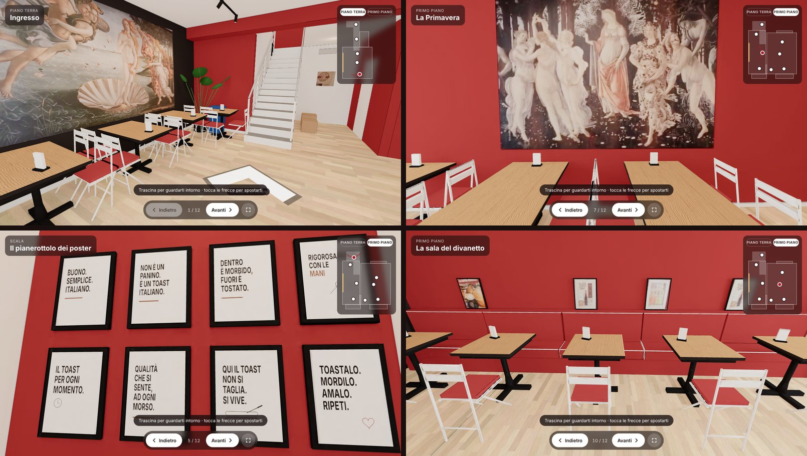

# Tour 3D della Toasteria

Visita virtuale in 3D del locale, ricostruita dal video girato all'interno. Si apre nel browser e
si naviga come su Google Street View: **frecce sul pavimento** per andare avanti e indietro,
**trascinamento** per guardarsi intorno, **Avanti / Indietro** per seguire il giro guidato,
**mini-mappa** dei due piani per saltare a un punto.



## Cosa contiene

| Percorso | Contenuto |
| --- | --- |
| `index.html`, `tour.js`, `tour.css` | Il visualizzatore (three.js, nessun servizio esterno). |
| `vendor/` | three.js r170 in locale (licenza MIT in `THREE-LICENSE.txt`). |
| `assets/toasteria.glb` | Il modello 3D con le texture. |
| `assets/lm_*.webp`, `assets/lightmaps.json` | La luce calcolata in Blender (lightmap) per i tre gruppi: piano terra, scala, primo piano. |
| `renders/` | Immagini statiche renderizzate con Cycles, utili anche per il sito e i social. |
| `source/` | Script Blender e Python per rigenerare tutto (vedi `source/README.md`). |

Il giro tocca 12 punti: ingresso, la *Nascita di Venere*, la scala, il pianerottolo con i poster,
l'arrivo al primo piano, la *Primavera*, la vetrata, il passaggio tra le sale, la sala del
divanetto, il muro di cassette e la seconda vetrata.

## Come metterlo sul sito (WordPress + Divi)

1. Carica l'intera cartella `toasteria-tour-3d` sul server, per esempio con FTP o con il file
   manager dell'hosting dentro `wp-content/uploads/`, così l'indirizzo diventa
   `https://tuosito.it/wp-content/uploads/toasteria-tour-3d/index.html`.
2. Nella pagina, aggiungi un modulo **Codice** di Divi e incolla:

   ```html
   <div style="position:relative;width:100%;aspect-ratio:16/9;min-height:440px;border-radius:14px;overflow:hidden">
     <iframe src="/wp-content/uploads/toasteria-tour-3d/index.html"
             title="Tour 3D del locale"
             style="position:absolute;inset:0;width:100%;height:100%;border:0"
             allow="fullscreen" allowfullscreen loading="lazy"></iframe>
   </div>
   ```

3. Per aprire il tour già su un punto preciso aggiungi `?punto=` all'indirizzo, per esempio
   `index.html?punto=primavera`. I nomi dei punti sono: `ingresso`, `venere`, `piedi-scala`,
   `scala`, `pianerottolo`, `arrivo`, `primavera`, `vetrata`, `passaggio`, `divanetto`,
   `cassette`, `vetrata-2`.

Il tour va aperto da un indirizzo web (http/https): se fai doppio clic su `index.html` dal disco il
browser blocca il caricamento del modello. Per provarlo sul computer apri un terminale nella
cartella e lancia `python3 -m http.server 8000`, poi vai su <http://localhost:8000>.

Peso totale da scaricare: circa 4 MB (modello 2,7 MB, luce 0,5 MB, three.js 0,7 MB), con barra di
avanzamento durante il caricamento. Funziona su Chrome, Safari, Firefox ed Edge, anche da telefono
(trascina con un dito, pizzica per zoomare).

## Comandi

| Azione | Mouse / touch | Tastiera |
| --- | --- | --- |
| Guardarsi intorno | trascina | ← → |
| Spostarsi | clic sulla freccia o sul pavimento | ↑ ↓ (o W, S) |
| Giro guidato | pulsanti Avanti / Indietro | N, P |
| Zoom | rotella o pizzico | — |

## Cosa è fedele e cosa è ricostruito

- **Fedele al video**: i due murales (*La Nascita di Venere* al piano terra e *La Primavera* al
  primo piano) sono stati ricomposti unendo decine di frame e raddrizzati; i testi degli otto
  poster del pianerottolo sono quelli reali; colori delle pareti, pavimenti, scala con ringhiera
  a cavi, tavoli con la scritta "Toasteria Italiana", sedie pieghevoli bianche con cuscino rosso,
  poltrone acapulco, divanetto rosso, muro di cassette, piante, binari luce.
- **Stimato**: le misure (non c'è un rilievo: le proporzioni vengono dai murales, dai gradini e
  dagli arredi) e le parti che il video non inquadra, come la parete destra del piano terra, che
  è stata lasciata bianca con tre poster.
- **Semplificato**: le piante e le poltrone acapulco sono modelli leggeri; la vista sulla strada
  dalle finestre è una foto presa dal video.

Per cambiare nomi o posizione dei punti di vista basta modificare l'elenco `NODES` in `tour.js`.
